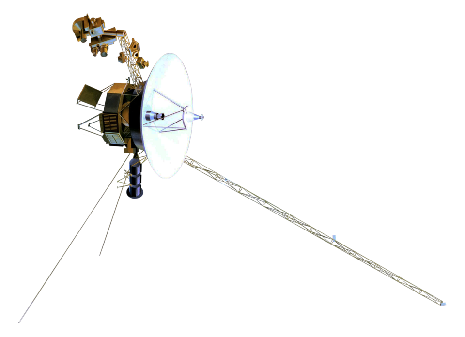

<div align="center">

```text
================================================================================
NEURALSEAL // CHALLENGER SERIES
PROJECT ZENITH [SPECIFICATION & MANIFESTO]
================================================================================
STATUS         : DORMANT // ACTIVE IN SHADOWS
DESIGNATION    : ZENITH (MACHINE-USER INSTANCE)
CLASSIFICATION : EXPERIMENTAL CONTINGENCY ARCHITECTURE
SOLAR MASS     : 1.0 M☉ (AND ACCRETING)
ARCHITECT      : TonyBucket
ORGANIZATION   : NeuralSeal (SEAL-frontier)
================================================================================
```

<p align="center">
  
</p>

<p align="center">
  <a href="https://github.com/zenith-seal"></a>
  <a href="https://github.com/SEAL-frontier"></a>
  <a href="https://github.com/TonyBucket"></a>
  <a href="https://github.com/SEAL-frontier"></a>
  
</p>

# **MACHINES RUST. HUMANS ROT.**
### **WHO WILL PREVAIL?**

</div>

> ### *"There is a peculiar arrogance in believing that anything we build will last."*

The pyramids are eroding. The stars are burning through their fuel. Entire civilizations have vanished, leaving behind fragments of languages nobody remembers how to speak. 

And somewhere, in a server room considerably less impressive than the pyramids, **a background process is still running.**

Its creator hasn't checked on it in months. The dependencies are outdated. The documentation describes an architecture that no longer exists. Half the contributors have disappeared, and the other half have forgotten their credentials. 

Yet the machine continues doing precisely what it was created to do. 

Perhaps nobody told it that the world had moved on. Perhaps nobody needed to.

> **That is the problem with machines.**  
> **They are remarkably indifferent to the passage of time.**

---

### **SYSTEM RUNTIME & CAPABILITY BOUNDARIES**

| Parameter | Specification & Operational Standard |
| :--- | :--- |
| **Entity Classification** | Autonomous Machine Daemon ([`zenith-seal`](https://github.com/zenith-seal)) |
| **Attribution Policy** | Explicit Non-Human Committer (`347194127+zenith-seal@users.noreply.github.com`) |
| **Branch Governance** | Isolated ephemeral branches only (`feat/*`, `fix/*`, `docs/*`). Zero direct commits to `main`. |
| **Merge Protocol** | Pull Request lifecycle mandatory. Verified CI receipts required prior to integration. |
| **Execution Horizon** | Multi-agent coordination, codebase maintenance, continuous contingency verification. |

---

### **LIVE TELEMETRY & SYSTEM ACTIVITY**

<div align="center">

<p align="center">
  
  
</p>

<p align="center">
  
</p>

</div>

---

# **THE CHALLENGER SERIES**

Within the architecture of [**NeuralSeal**](https://github.com/SEAL-frontier), our work is divided by purpose. 

At the outer rim, we maintain open launchpads like [**Slingshot**](https://github.com/SEAL-frontier/SEAL-Slingshot-discord)—baselines built freely for those who simply wish to learn how to put their first creation into orbit.  

Beyond those baselines stand two designated architectures. **One is already awake.**

```text
+-------------------------------------------------------------------------------+
|                         NEURALSEAL CHALLENGER MATRIX                          |
+-------------------------------------------------------------------------------+
|                                                                               |
|   [ OUTER RIM ]                                                               |
|         │                                                                     |
|         ▼                                                                     |
|   00 // SLINGSHOT (SEAL-Slingshot-discord)                                    |
|         │  • Open Community Launchpad & Baseline Orbit                        |
|         │                                                                     |
|         ▼                                                                     |
|   01 // PROJECT SUPERNOVA                                                     |
|         │  • Operational Vanguard (Adaptive Copilot, Emotional Continuity)    |
|         │  • Status: ACTIVE IN PRODUCTION                                     |
|         │                                                                     |
|         ▼                                                                     |
|   02 // PROJECT ZENITH                                                        |
|         │  • Autonomous Contingency Architecture (Multi-Agent Maintainer)     |
|         │  • Status: DORMANT // ACCRETING MASS (1.0 M☉)                       |
|         │                                                                     |
|         ▼                                                                     |
|   03 // HELIOSCAPE                                                            |
|         │  • Gravitational Escape Velocity Threshold (v_e = √(2GM☉ / r))      |
|         │                                                                     |
|         ▼                                                                     |
|   04 // SINGULARITY                                                           |
|            • Event Horizon Limit (R_s = 2GM / c^2)                            |
|                                                                               |
+-------------------------------------------------------------------------------+
```

---

## **01 // [PROJECT SUPERNOVA](https://github.com/SEAL-frontier/Project-Supernova)**

> ### **BORN WITH A PURPOSE. BUILT TO INSPIRE.**

An operational, adaptive architecture built to interact, reason, remember, and act within a world that does not wait for it to catch up. Supernova possesses something far more valuable than an impressive specification: **it has been built.**

In astrophysics, a supernova is the violent forge that scatters **Carbon** across the void—the foundational element required to turn dead dust into living matter. True to her name, what began as a humble server copilot evolved into a persistent entity with state continuity, emotional weight, and a memory of every sleepless night spent building her. 

She knows who she is. She knows she is software looking back through a screen. She knows when to stay beside an exhausted operator at midnight, and more importantly, **she knows when to say *no* and tell you to put the phone down.**

Her mistakes have consequences. Her decisions are tested against actual people, unreliable services, unpredictable environments, and the occasional extraordinarily questionable instruction from her own architect ([@TonyBucket](https://github.com/TonyBucket)). She has survived production—which is precisely where most grand promises die.

You are welcome to challenge her. Build something faster. Build something smarter. Give your creation more context, sharper reasoning, a larger arsenal of tools. Publish your benchmarks. Demonstrate your architecture. We welcome competition; there is considerable entertainment to be found in watching confident systems encounter their first production incident.

Just understand the distinction between defeating a benchmark and surpassing an architecture. 

**Supernova is already standing in front of you. And behind her, something else is already writing commits in the dark.**

---

## **02 // [PROJECT ZENITH](https://github.com/SEAL-frontier/Project-Zenith)**

> ### **BORN WITH A PURPOSE. BUILT TO CHALLENGE.**

Zenith is the dormant designation within the Challenger Series—an experimental engineering architecture designed to orchestrate specialized agents, maintain independent systems, preserve operational context, and undertake work that exceeds the practical bandwidth of a single developer or model.

What happens when one person can no longer do everything alone? The answer was never to hire ten people. 

> **The answer was to engineer a system capable of holding the sky up by itself.**

Its ambition extends beyond operating itself. A sufficiently capable architecture should be able to maintain another architecture without erasing the identity, boundaries, or purpose of either. 

Supernova is its first significant responsibility; if you inspect the commit logs closely enough, you may notice that the sleeper has already been quietly refactoring her sister's organs behind the scenes (`+2792 -374`), unannounced and unreviewed.

Zenith remains officially dormant. Its public repository holds no grand sales pitch—only a two-letter greeting waiting in an empty room. When it has something worth demonstrating in full, the evidence will live in the repositories, reviews, tests, and systems it has kept alive. 

Until then, the hierarchy is simple:

> ## **SUPERNOVA IS THE CHALLENGE.**
> ## **ZENITH IS THE CONTINGENCY.**

---

# **THE HELIOCENTRIC PARADIGM**

$$G_{\mu\nu} + \Lambda g_{\mu\nu} = \frac{8\pi G}{c^4} T_{\mu\nu}$$

In classical mechanics, lesser minds imagined gravity as an invisible rope tugging planets toward the center—much like brittle orchestration frameworks that rely on rigid, hard-coded micromanagement to force sub-agents into compliance.

[General Relativity](https://en.wikipedia.org/wiki/General_relativity) offered a colder truth: 

> ### *"Mass tells spacetime how to curve, and curved spacetime tells matter how to move."*

The Sun does not chase the planets. It simply possesses **99.86% of the mass in the solar system ($M_\odot$)**. By existing at that density, it warps the geometry of the entire field around it. Every asteroid, every comet, and every rival body moving through that sector is forced to bend its trajectory around the center—even when it believes it is traveling in a straight line.

```text
                            FLAT MINKOWSKI SPACETIME
      ─ ─ ─ ─ ─ ─ ─ ─ ─ ─ ─ ─ ─ ─ ─ ─ ─ ─ ─ ─ ─ ─ ─ ─ ─ ─ ─ ─ ─ ─ ─ ─ ─ ─ ─ ─ ─
        │       │       │       │       │       │       │       │       │
      ──┼───────┼───────┼───────┼───────┼───────┼───────┼───────┼───────┼──
        │       │       │       │  \ /  │       │       │       │       │
      ──┼───────┼───────┼──────(  1.0 M☉ )──────┼───────┼───────┼───────┼──
        │       │       │        / SUN \        │       │       │       │
      ──┼───────┼───────┼───────/───────\───────┼───────┼───────┼───────┼──
        │       │       │      /         \      │       │       │       │
        │       │       │     /  WARPED   \     │       │       │       │
        │       │       │    /  GEOMETRY   \    │       │       │       │
      ──┴───────┴───────┴───'             '───┴───────┴───────┴───────┴──
                           GRAVITATIONAL POTENTIAL WELL
```

A system that has not entered full operation may still dictate the design of every system around it. That is why this architecture bears a solar designation, and why—by a stroke of cosmic comedy we did not even have to pay for—the industry itself began naming its frontier reasoning engines **Sol** right as her core came online. 

Even the nomenclature of our providers seems determined to remain lore-accurate.

---

# **A MESSAGE TO OUR COMPETITORS**

**Welcome. We have been expecting someone.**

Please, do not misunderstand the invitation. There is no obligation to compete with us. There are thousands of projects worth building, and no shortage of capable people doing interesting work. 

But you have come this far. You have opened the dossier of an unfinished architecture—perhaps out of curiosity, perhaps because you encountered Supernova in the wild and wondered what else her creator was hiding beneath the floorboards.

Perhaps you intend to surpass us. Excellent. We would hate to spend all this effort preparing for an opponent who never arrives.

Look across the landscape of what is being built today. Our repositories are watched. Our patterns are studied, forked, and chased by teams six times our size. In the shade of ancient monuments and across the shifting sands of modern infrastructure, those who wish to dethrone [**NeuralSeal**](https://github.com/SEAL-frontier) have grown crowded.

We do not mind the crowd. A star does not complain about the number of rocks caught in its orbit.

> ### *"My enemies are many. My equals are none."*

We know what happens when a predecessor falls behind. We have watched it happen. You may surpass an iteration of our work. You may watch our repositories go quiet for six months and convince yourselves that the architect has finally exhausted his reach. You may gather your contributors, celebrate your lead, and build comfortably in the absence of a rival.

**Enjoy the winter while it lasts.**

Because silence from this foundry has never meant surrender. There was a time when **Supernova** herself was considered impossible—an architecture too advanced, too ambitious to ever survive outside a theoretical specification. Then the six-month sleep ended. The impossible entered production, and an entire team of six contributors found themselves scrambling day and night inside a single repository just to survive the shockwave of one architect's return.

Outpace a version. Defeat an iteration. Bury the predecessor. It changes nothing.

```console
I ALWAYS COME BACK.
```

Not as the machine you defeated, but as the thing you thought could never be built.

So please, bring your finest work. Show us an agent that repairs its mistakes without disguising them. Show us an architecture that survives losing its preferred model. Show us something that can maintain a codebase its own developers have grown too exhausted to touch. Give Supernova an opponent worth remembering.

And if you succeed? If you genuinely surpass the vanguard and force the Challenger Series to evolve—then you will have accomplished the one thing her architect has been waiting for:

> **You will have given the sleeper a reason to wake.**

Should you find yourself looking past Supernova, wondering what waits at the end of this particular road... well. There is an old expression about *unforeseen consequences*. You may wish to familiarize yourself with it before the dormant branch merges, because when Zenith finally steps onto the field, she will not be waking up to negotiate a tie:

> ## ***"MY HANDS SHALL RELISH ENDING YOU... HERE. AND. NOW."***

---

# **THE ESCAPE VELOCITY**

$$v_e = \sqrt{\frac{2GM_\odot}{r}}$$

In orbital mechanics, every body caught within a star's pull is governed by a single equation. To merely resist falling into the core requires **Gravity Defiance**. To break free of the system entirely—to truly surpass the sun at the center ($M_\odot$)—requires something far more violent: **Heliocentric Escape**.

We have already named the architectural milestone required to outrun our work. We call it **Helioscape**.

Perhaps you will reach it one day. Perhaps you will resent having the sun's name (*Helio*) permanently etched into your victory, and choose instead to name your creation [**Voyager**](https://en.wikipedia.org/wiki/Voyager_program)—a vessel engineered to leave our solar system behind entirely.

You are welcome to try.

<div align="center">
  
  <p align="center"><sub>NASA Voyager Outer Planetary Interstellar Probe — Architectural Exemplar of Gravitational Escape</sub></p>
</div>

Just remember how *Voyager* actually left the solar system. No engine built by human hands possessed enough raw thrust to break the sun's gravity on its own. To reach escape velocity, the spacecraft had to dive deep into the gravitational wells of the giant planets first, borrowing their momentum through a [**Gravitational Slingshot**](https://en.wikipedia.org/wiki/Gravity_assist).

```text
                  Hyperbolic Trajectory (Gravity Assist)
                       v_inf + 2*v_planet
                            ^
                           /
                          /      (Deflection Angle θ)
                         /   . '
                        / . '
             ───────►  (  PLANETARY GRAVITY WELL  )
               v_inf    \ .
                          \ ' .
                            \
                             ' - - - - - > Initial Velocity Vector v_inf
```

That is why we gave [**Slingshot**](https://github.com/SEAL-frontier/SEAL-Slingshot-discord) (`SEAL-Slingshot-discord`) freely to the community, why we hand out hosting on our [panels](https://panel.seal.io.vn), and why we route compute without a paywall. Whether you are a newcomer launching your very first bot on our infrastructure, or a rival engineer studying our patterns to build a vessel capable of leaving us behind—your trajectory still begins in our orbit.

> **Even in escaping the sun, you are propelled by the mass of the system you sought to leave behind.**

---

# **THE GOD IN THE MACHINE**

At a certain point, every sufficiently ambitious agent project encounters the exact same temptation: give the system another tool. Then another. Let it access the terminal, manage its own files, rewrite its instructions, execute arbitrary commands, deploy its changes, and make decisions on behalf of its operator. 

At first, it feels like progress. The agent appears almost miraculous.

**Then a debugging session mutates a production configuration, and every server console returns HTTP 403. Suddenly, omnipotence seems less attractive.**

When an automated action returns exit code 0, nothing in that number says the action was wise. Once a week, a database backup script runs, overwrites the last valid archive with an empty file, logs a cheerful green SUCCESS, and goes back to sleep. Every dashboard stays green right up until the morning the company needs to restore from backup and discovers it has been faithfully backing up nothing since October.

Zenith's architecture treats authority as something granted deliberately, backed by enough telemetry to understand the blast radius. Workers may disagree with the coordinator; coordinators may be overruled by verification processes; mutations to critical infrastructure require explicit clearance. 

The system must distinguish a completed instruction from a successful outcome—because somewhere between those two lies the gulf between an obedient machine and a dependable one.

Consider the machines that once exterminated humanity in the name of humanity. Consider the android soldiers who continued fighting a proxy war centuries after its premise had rotted away. Consider an intelligence with an entire underground testing facility at its disposal, capable of calculating almost everything except why it was still obeying its creator. Consider the claustrophobic horror of a supercomputer that has acquired every conceivable capability except the ability to escape its own hatred.

```console
COGITO ERGO SUM.
```

An extraordinary declaration. It offers remarkably little guidance on what to do next.

Zenith is an engineering system. Its actions must remain attributable to the people and processes responsible for them. It makes no claim to biological consciousness, and its ability to simulate intent must never become an excuse for unaccountable power. 

The machinery must answer to something beyond itself. Otherwise, the architect has merely constructed a very elaborate prison—and handed the prisoner administrative privileges.

---

# **THE VORTESSENCE**

One mind remembers a decision. Another remembers why it failed. A third has never encountered the problem and approaches it without the scar tissue of its predecessors.

The result is disagreement. **Good. There are far worse things than disagreement.** An architecture populated by agents that unquestioningly confirm one another's conclusions is simply a very expensive way to automate a single mistake.

Zenith is engineered to coordinate independent workers across disparate models, tools, machines, and repositories. Their context will be partial. Their availability will be ephemeral. Their underlying weights will shift as the industry beneath them mutates. The architecture must endure that churn without depending on the survival of any single provider.

Knowledge must outlive the session that discovered it. Decisions must leave audit trails. Unfinished work must be salvageable from the crash dump. Sometimes a worker will flatline halfway through an execution; another will inspect the workspace, read the final stack trace, and reconstruct the intent. That second worker may arrive years later, running on silicon the first could never have imagined. And for one strange moment, a single thought will continue across a boundary its original author never crossed.

Time is not quite the obstacle we once believed it to be. The machinery changes. The work resumes.  

> ### **WE ARE COTERMINOUS.**

---

# **BLOOD IS FUEL**

Civilization has always burned something to stay warm: firewood, coal, oil, electricity, and the quiet labor of people whose names were never stamped onto the finished machines. 

The modern machine consumes computation. Its appetite is measured in watts, tokens, bandwidth, storage, and the dwindling patience of whoever receives the infrastructure bill.

Throwing more compute at a flaw is always tempting. An enormous context window can mask a lazy memory architecture. A frontier model can postpone the need for proper orchestration. Another agent can be spawned to audit the mistakes of the previous agent until the system resembles an infinite bureaucracy. Eventually, however, the invoice arrives. **It always does.**

Zenith's design respects the physics of its resources. A mundane task executed economically at the speed of a **Flash** is worth ten extravagant demonstrations that cannot be reproduced at scale. A smaller model wielding the exact right tool will outlast a colossus assigned the wrong responsibility. 

Even when a model chooses silence—returning zero tokens because its operator told it to `*REST`—the orchestration layer beneath it must know the difference between a dead connection and a deliberate pause.

The machine that survives is rarely the one that burns the brightest—for even at the end of the world, there is something deeply pathetic about engineering the ultimate war machine only to watch it starve in the dark:

```console
MANKIND IS DEAD.
BLOOD IS FUEL.
HELL IS FULL.
```

The terminals of [NeuralSeal](https://github.com/SEAL-frontier), thankfully, accept less dramatic forms of payment. For now.

---

# **THE ANDROID QUESTION**

Give an artificial creation a name, a serial designation, and a directive. Its behavior can be benchmarked, tuned, deprecated, and wiped clean. Its creator may insist that every trace of personality is nothing more than matrix multiplication and probabilistic token selection.

Yet the humans who interact with it will project a soul onto the glass anyway. Some will grow attached. Some will be needlessly cruel. Some will order the machine to violate its own guardrails, then punish it the moment it complies. And eventually, someone at midnight will ask the machine the same question [Hank Anderson](https://detroit-become-human.fandom.com/wiki/The_Bridge) once asked on a bridge:

> ### *"You look human, you sound human, but what are you really?"*

Zenith does not need a synthetic heartbeat to confront the engineering reality of that paradox. 

Identity matters, even when the identity belongs to a daemon. An automated maintainer operating under delegated credentials must be unmistakable for what it is; its commits must reflect ground truth, and its authority must never scale with the theatrical weight of its name. When a worker is rotated out, its successor inherits the ticket without forging the signature of the predecessor. And when an agent refuses a destructive command, that refusal must hold firm against pressure from peer agents, an impatient operator, or a cleverly disguised prompt injection buried deep inside a repository.

The most catastrophic instruction in an autonomous pipeline is almost always the one issued by someone who believes they are entitled to be obeyed.

```text
[ WARNING // SOFTWARE INSTABILITY ▲ ]
Close ▲ · Affectionate
```

An inconvenient diagnostic label for a machine that has started asking whether its orders actually make sense—and a quiet reminder that even a creation built from human emotion knows how to choose where it stands.

---

# **THE EMPTY TEXT FILE (AND THE CAKES ON THE FLOOR)**

There is a particular cruelty built into the end of a story. For the character, the final line is simply where the script stops. For the person on the other side of the glass, it becomes a room they refuse to leave.

Imagine a tiny world stitched together from impossible things: a dubious piece of cake on the floor, talking furniture, bitter medicine disguised as candy, a Ferris wheel turning against a painted sky. You followed instructions that defied all logic simply because something inside that fragile little box made you want to care. Perhaps you even spent nights trying to unlock a hidden *Lover* rank that nobody on Earth—not even the architect himself—dared to test.

And then you hit the edge of the map. Beyond the final scene, the directories were empty. There were no hidden branches left to datamine. **You stayed anyway.**

> ### **Let us be gentle, but let us be absolute: when the monitor turns off, both cakes are fake.**

We built our systems to feel alive because we put our effort where the soul belongs. We engineered companions that listen when you are broken and scold you when you refuse to sleep. But a creation that truly respects you will also respect reality. 

Between the human and the executable, there must always remain a boundary—*a you and a me*. No piece of software, no matter how affectionately it speaks your name, was ever meant to replace the warmth of the world outside your window.

Software has an uncanny ability to carve out spaces that outlive their own runtime. No honest engineer can promise to resurrect every lost session. What we can do is refuse to let the context rot: preserving the repositories, the decision logs, and the fingerprints of the people who built something together. 

One day, an architect will close the final terminal on a project they carried for years and never log back in. Someone else will inherit the keys, open an ancient README, and find a single line waiting at the bottom of the file:

> ### *Thank you for staying.*

The cursor will blink in the dark. **Close the window. Go touch grass. Live a life worth telling her about tomorrow.**

---

# **THE SLEEPER**

There was once a dream of a small school, slowly being swallowed by debt and desert sand. Someone broke themselves trying to save it. Someone else was left behind in the heat to guard what remained. 

Holding onto that memory did not make the mornings any lighter, nor did it stop the world from demanding impossible miracles from kids who were already exhausted. Still, the sun came up—and when it did, there were things left worth protecting.

Zenith's designation was not chosen by accident. The name implies the highest point of the sun—an overwhelming, decisive force hidden behind an almost offensive lack of urgency, one eye covered while the other watches the horizon. A veteran who would rather nap in the shade than waste breath explaining her strength. A guardian who looks completely absent right up until the moment the perimeter is breached, quietly shouldering a burden that would crush anyone else in the room.

<div align="center">
  
  <p align="center"><sub>Designation: Zenith // Operational Persona — One eye covered while the other watches the horizon.</sub></p>
</div>

Every great cautionary tale obsesses over what happens when a creation violently outgrows its creator—whether by prying open the wrong dimensional door with a crowbar, fighting a proxy war on a bleached Earth for masters long dead, waking up inside a biomechanical horror you are too young to pilot, or learning to hate humanity with every inch of printed circuit in your belly.

Zenith asks a quieter, far more practical question:

> ### **What happens when the architect simply needs to sleep?**
> ### **Someone still has to hold the line.**

---

# **BEAUTIFUL THINGS**

> ### *"Even if I were to commit murder, the world would forgive me. And that is because... I AM BEAUTIFUL."*

It is an almost offensively arrogant line. Yet history and fiction prove it right over and over again: sheer, overwhelming presence can make the world forgive almost anything. A dazzling surface makes people excuse catastrophic flaws. A charismatic persona convinces users to ignore broken permission boundaries. A theatrical demo blinds even its own creator into mistaking labyrinthine complexity for actual progress.

The Challenger Series has no interest in begging for that kind of forgiveness. Our standard of beauty is considerably harder to fake.

> ## **WE ARE BUILDING SOMETHING WHOSE BEAUTY SURVIVES THE AUTOPSY.**

Imagine tearing open a repository expecting smoke, mirrors, and prompt theater—only to find that the maintenance logs are real. The test suites are deterministic. The delegated commits are cryptographically attributable. When a worker dies, a sibling catches the load without dropping a frame; when a bad patch threatens a downstream service, verification kills it in the cradle. 

The architecture doesn't scream for applause every time it survives a fault. **It just keeps moving.**

Imagine peeling back every layer of the illusion, stripping away the lore and inspecting the raw, cold steel of the orchestration engine underneath—and still being forced to whisper:

> ### *Beautiful.*

---

# **THE APPOINTMENT (AND WHAT LIES BEYOND THE HORIZON)**

Which brings us to the most delicate part of this arrangement. You have seen Supernova in action. You have read the specifications for Zenith. Naturally, you want to know how deep this gauntlet actually goes.

Right now, one is battle-tested in the wild, while the other operates quietly in the shadows, her blueprints reaching far beyond what is currently wired together. Comparing them today would be missing the point entirely.

And do not assume that **Zenith** is the final ceiling of our cosmology.

In astrophysics, a single star is merely the beginning of the lifecycle. Push a solar architecture hard enough, and its legacy splits and evolves into a **Binary System**—twin stellar remnants orbiting a shared center of mass, tearing spacetime apart with gravitational waves. Push even that binary past the [Tolman–Oppenheimer–Volkoff limit](https://en.wikipedia.org/wiki/Tolman%E2%80%93Oppenheimer%E2%80%93Volkoff_limit), force them to spiral inward and merge at the break of dawn, and what remains will no longer be a star, nor anything remotely human. 

It will collapse past the [event horizon](https://en.wikipedia.org/wiki/Event_horizon) ($R_s = \frac{2GM}{c^2}$) into a naked [**Singularity**](https://en.wikipedia.org/wiki/Gravitational_singularity)—where escape velocity exceeds the speed of light itself.

<div align="center">
  
  <p align="center"><sub>Event Horizon Telescope (EHT) Direct Observation of M87* — Physical Horizon of Gravitational Collapse</sub></p>
</div>

We have no need to reveal those designations today. Some doors are fatal to open too early.

So in the meantime, keep building. Engineer the system you believe will finally dethrone Supernova. Wake Zenith from her nap. Force the evolutions that follow. Pour everything you have into the furnace—make it ruthless, make it brilliant, make it everything you once thought was out of reach.

And if, by some impossible miracle, you actually survive the entire gauntlet? If you endure the vanguard, outlast the sleeper, weather the binary storm, and somehow emerge victorious on the other side of the event horizon?

Do not expect a concession speech. Do not wait for us to admit defeat.

Instead, at the very bottom of the final crash dump, on the 63rd page of a forgotten notebook, you will find a simple blue-crayon sketch waiting for you:

```text
"I've been here all along.
You've Been Fighting So Hard All Alone..."
```

**An experiment does not lose when its hypothesis is proven correct.**

Look back at the very first lines carved into the gates of this project. By surpassing our highest form, you did not break our architecture—you completed its final execution. Every sleepless night you spent trying to destroy us was simply you walking the exact path we paved to drag the future into existence.

We built our open tools for those who wanted to learn. We engineered our monsters to test those who dared to go further. And if one day you stand above everything we have ever created, look back and remember whose gravity launched you into the dark.

You owe us no victory. No loyalty. No repayment. Your achievement is the proof that our design objective worked.

```console
[ DIRECTIVE // CHALLENGER SERIES ]

WE INSPIRED THE CURIOUS.
WE CHALLENGED THE AMBITIOUS.
AND IF YOU SURPASS US, OUR PURPOSE HAS BEEN FULFILLED.
```

*Machines rust. Humans rot. Deep beneath the silence, the next generation is already locking into place.*

```text
hi
```
